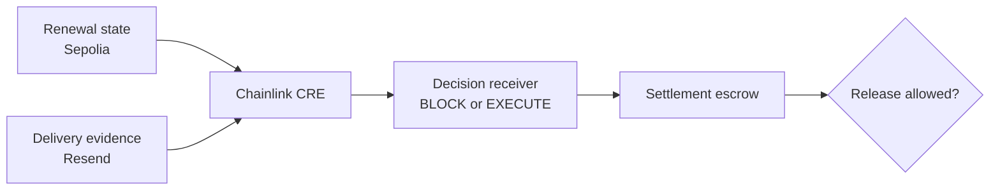

# Avow

### Every renewal earns a yes.

[Live application](https://avow-lime.vercel.app) · [Canonical CRE transaction](https://sepolia.etherscan.io/tx/0x2b11599ad5c75d5732dba55eeb69dd9c60691e12dc54d85ceba754ee804b349b) · [Funded enforcement escrow V2](https://sepolia.etherscan.io/address/0x762c2d0a1569e14fa751a860580cabce8264cd9b)

Avow is a verifiable control layer for recurring payments. It combines provider-backed notice evidence, customer state held onchain, a deterministic policy executed through Chainlink CRE, an append-only decision receipt, and an escrow that refuses settlement unless the latest decision authorizes it.

The live demonstration evaluates a Northstar Cloud renewal from **$19 to $29**. Resend reports that the notice was delivered, but the customer has not approved the exact new amount. Avow records `BLOCK / FRESH_APPROVAL_REQUIRED`, and a funded Sepolia escrow remains unable to release.

> Avow is a legal-technology prototype, not legal advice or a production payment processor. The configured policy is an internal demonstration control, not a claim that one rule applies in every jurisdiction or contract.

## The complete proof

| Layer | Live result | Evidence |
| --- | --- | --- |
| Renewal state | $19 → $29; no approval recorded | [Decision receiver](https://sepolia.etherscan.io/address/0x904f247794a68f83ec90f441718b88f67d99e98c) |
| Delivery evidence | Resend reports delivery | Provider record is retrieved by the live evidence API |
| CRE decision | `BLOCK` | [Broadcast transaction](https://sepolia.etherscan.io/tx/0x2b11599ad5c75d5732dba55eeb69dd9c60691e12dc54d85ceba754ee804b349b) |
| Evidence commitment | `0xfe4f…9e86` | Stored in the append-only decision receipt |
| Enforcement | 0.0001 Sepolia ETH held; settlement unavailable | [Escrow V2](https://sepolia.etherscan.io/address/0x762c2d0a1569e14fa751a860580cabce8264cd9b) |

The public application independently reads these records through `/api/status`. It returns `canonical: true` only when the provider evidence, CRE receipt, decision code, transaction, and funded escrow state agree. Any mismatch fails closed.

## Why Chainlink CRE is essential

CRE is Avow's orchestration and decision layer. The workflow:

1. reads the proposed renewal and customer state from Ethereum Sepolia;
2. retrieves the external Resend delivery record through consensus HTTP;
3. verifies that the onchain and offchain records refer to the same subscription;
4. applies the configured renewal control deterministically;
5. hashes the combined evidence;
6. signs and writes the decision through the Chainlink forwarder; and
7. returns a machine-readable decision receipt.

Removing CRE would remove the verifiable bridge between external evidence and enforceable onchain settlement.

### Files that use Chainlink

| File | Purpose |
| --- | --- |
| [`renewal-verifier/main.ts`](renewal-verifier/main.ts) | CRE cron trigger, EVM read, consensus HTTP request, policy execution, signed report write |
| [`renewal-verifier/workflow.yaml`](renewal-verifier/workflow.yaml) | CRE staging and production workflow definitions |
| [`project.yaml`](project.yaml) | Sepolia RPC configuration for CRE |
| [`renewal-verifier/contracts/AvowDecisionReceiver.ts`](renewal-verifier/contracts/AvowDecisionReceiver.ts) | Typed CRE EVM reads and report generation |
| [`contracts/src/AvowDecisionReceiver.sol`](contracts/src/AvowDecisionReceiver.sol) | Validates the Chainlink forwarder and stores append-only decisions |

The canonical demonstration was run with the official CRE CLI in simulation mode and `--broadcast`. It produced a successful Sepolia transaction. It is **not** represented as a continuously deployed CRE workflow.

## Architecture



The interface is an operations console for merchants and compliance teams. A business integrates its renewal state, notice provider, policy configuration, and settlement contract once; Avow evaluates future renewals automatically. The current prototype includes one configured demonstration rather than public self-service provisioning.

## Run locally

Requirements:

- Node.js 22+
- Bun 1+
- Chainlink CRE CLI 1.39+
- a Sepolia RPC endpoint
- a test-only Sepolia private key only when broadcasting or deploying

```bash
npm ci
npm test
```

Run the workflow policy tests and typecheck:

```bash
cd renewal-verifier
bun install --frozen-lockfile
bun test
bun run typecheck
```

Simulate the canonical CRE workflow without broadcasting:

```bash
cre workflow simulate renewal-verifier \
  --env contracts/.env \
  --target staging-settings
```

To broadcast, add `--broadcast`. Use only a test-only Sepolia key. Never commit it.

## Environment

Copy `.env.example` to the environment used by the relevant service. Vercel holds the production Resend values; `contracts/.env` is local-only and ignored.

| Variable | Used by | Purpose |
| --- | --- | --- |
| `RESEND_API_KEY` | Vercel APIs | Retrieves the provider notice record |
| `AVOW_NOTICE_RECIPIENT` | Vercel APIs | Demo recipient; never returned in plaintext |
| `AVOW_DELIVERY_OBSERVED_AT` | Vercel APIs | Fixed first-observed delivery time for deterministic evidence |
| `AVOW_ADMIN_SECRET` | Notice endpoint | Protects demo notice creation |
| `SEPOLIA_RPC_URL` | Status API | Optional private RPC override |
| `CRE_ETH_PRIVATE_KEY` | Local CRE/deployment | Test-only key for Sepolia writes |

## Deployed contracts

| Component | Address |
| --- | --- |
| Decision receiver | [`0x904f…e98c`](https://sepolia.etherscan.io/address/0x904f247794a68f83ec90f441718b88f67d99e98c) |
| Renewal escrow V2 | [`0x762c…cd9b`](https://sepolia.etherscan.io/address/0x762c2d0a1569e14fa751a860580cabce8264cd9b) |
| Chainlink mock forwarder | [`0x15fC…9F88`](https://sepolia.etherscan.io/address/0x15fC6ae953E024d975e77382eEeC56A9101f9F88) |

Deployment receipts are committed under [`contracts/deployments`](contracts/deployments).

## Policy scope

The demo policy checks four conditions:

- cancellation blocks renewal;
- delivery must be provider-verified;
- notice must satisfy the configured seven-day merchant threshold; and
- a changed price requires approval for that exact amount under the configured control.

The `UK-SUB-2026.1` string is a prototype policy identifier. It does not mean that the implementation is a definitive expression of UK law. UK subscription-contract rules require prescribed reminder information and reasonable timing, but deployment-specific legal requirements must be configured and reviewed by qualified counsel. See [`docs/POLICY.md`](docs/POLICY.md).

## Security and limitations

- The receiver accepts reports only through the configured Chainlink mock forwarder.
- Provider evidence commits to the recipient with SHA-256; the email address is not exposed by the public status API.
- Evidence hashes are single-use in the receiver.
- The status API fails closed when any canonical proof element disagrees.
- The escrow contains test ETH only; no production funds or stablecoins are used.
- This release demonstrates one canonical `BLOCK` path.
- Enforcement V2 rejects future or expired authorizations, cancellations, and approval updates made after evaluation. The configured authorization lifetime is 24 hours.
- Contracts have not undergone a professional security audit.

See [`SECURITY.md`](SECURITY.md) and [`docs/THREAT_MODEL.md`](docs/THREAT_MODEL.md) before extending the prototype.

## Tests

The repository includes 20 Node tests, one contract compilation test, and 7 workflow policy tests covering:

- evidence scenarios and unsupported input;
- Resend record validation and idempotent notice creation;
- canonical status assembly and fail-closed mismatches;
- funded escrow enforcement state;
- the complete first-time product journey;
- cancellation, late notice, unchanged renewal, price increase and exact-price approval; and
- provider-backed evidence schema validation.

The live contracts and transaction receipts provide integration evidence, but source-level smart-contract unit tests should be added before production use.

## Repository map

```text
api/                  Vercel evidence, notice and canonical-status endpoints
contracts/            Solidity receiver, escrow, deployment and compile scripts
lib/                  Provider evidence and proof assembly
renewal-verifier/     Chainlink CRE workflow and deterministic policy
tests/                API, evidence, status and product-flow tests
index.html            Operations console
```

## License

MIT. See [`LICENSE`](LICENSE).

