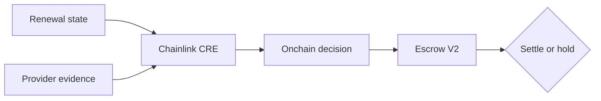

# Avow

## Recurring payments should prove permission.

[Live product](https://avow-lime.vercel.app) · [Verified CRE transaction](https://sepolia.etherscan.io/tx/0x2b11599ad5c75d5732dba55eeb69dd9c60691e12dc54d85ceba754ee804b349b) · [Funded enforcement escrow](https://sepolia.etherscan.io/address/0x762c2d0a1569e14fa751a860580cabce8264cd9b)

Avow is an open-source verification and enforcement layer for recurring payments. Before a renewal settles, Avow verifies provider-backed notice, exact-price consent and current customer state. A Chainlink CRE workflow evaluates the configured policy, records `EXECUTE` or `BLOCK` onchain, and a settlement contract enforces the result.

The reference implementation proves one complete path on Ethereum Sepolia: a renewal increases from **$19 to $29**, delivery is verified, exact-price approval is missing, CRE records `BLOCK / FRESH_APPROVAL_REQUIRED`, and a funded escrow refuses to release.

> Avow is a legal-technology reference implementation—not legal advice, an audited payment processor or a claim that one policy applies to every contract or jurisdiction.

## Why Avow exists

Recurring-payment systems usually separate compliance evidence from payment execution. A platform may send a notice, store consent somewhere else, and still rely on its own billing service to decide whether funds move. That creates an avoidable trust gap: the system making the charge is also the system asserting that the charge is permitted.

Avow closes that gap by turning independently verifiable evidence into a settlement condition.

| Without Avow | With Avow |
| --- | --- |
| Evidence and settlement are separate | Evidence determines whether settlement is available |
| The merchant can self-assert that notice was sent | Delivery is checked against a provider record |
| A stale decision may ignore later customer action | Escrow V2 requires current customer state and a fresh decision |
| Compliance review happens after funds move | The control runs before release |

## The verified reference proof

| Layer | Verified result | Public evidence |
| --- | --- | --- |
| Renewal state | $19 → $29; exact-price approval absent | [Decision receiver](https://sepolia.etherscan.io/address/0x904f247794a68f83ec90f441718b88f67d99e98c) |
| External evidence | Resend reports notice delivery | Retrieved and validated by the evidence service |
| CRE evaluation | `BLOCK / FRESH_APPROVAL_REQUIRED` | [Broadcast transaction](https://sepolia.etherscan.io/tx/0x2b11599ad5c75d5732dba55eeb69dd9c60691e12dc54d85ceba754ee804b349b) |
| Evidence commitment | `0xfe4f340c…9e86` | Stored in the append-only decision receipt |
| Enforcement | 0.0001 Sepolia ETH remains held | [Escrow V2](https://sepolia.etherscan.io/address/0x762c2d0a1569e14fa751a860580cabce8264cd9b) |

The live application reads the proof through [`/api/status`](https://avow-lime.vercel.app/api/status). It reports `canonical: true` only when the provider evidence, CRE receipt, decision, transaction and funded escrow state agree. A mismatch fails closed.

### Verify it in under one minute

1. Open the [live product](https://avow-lime.vercel.app).
2. Select **Verified demo**.
3. Choose **Inspect live proof**.
4. Review the provider evidence, CRE receipt and funded escrow.
5. Open the Etherscan links to inspect the transaction and contract independently.

The demo is one fixed, disclosed test renewal. It is not visitor data and does not pretend to be a public customer account.

## Why Chainlink CRE is essential

CRE is not a decorative integration. It is the orchestration and evaluation layer that connects external evidence to enforceable onchain state.

The workflow:

1. reads the proposed renewal and customer-state version from Sepolia;
2. retrieves external notice evidence through consensus HTTP;
3. checks that the onchain and offchain records refer to the same subscription;
4. validates delivery, notice timing, cancellation and exact-price approval;
5. produces a deterministic `EXECUTE` or `BLOCK` result;
6. commits the combined evidence with a hash; and
7. writes the signed report through the Chainlink forwarder.

Without CRE, Avow loses the verifiable bridge between provider evidence and onchain settlement.

| Chainlink integration file | Responsibility |
| --- | --- |
| [`renewal-verifier/main.ts`](renewal-verifier/main.ts) | Trigger, EVM read, consensus HTTP, policy evaluation and report write |
| [`renewal-verifier/workflow.yaml`](renewal-verifier/workflow.yaml) | CRE workflow targets |
| [`project.yaml`](project.yaml) | Sepolia configuration |
| [`renewal-verifier/contracts/AvowDecisionReceiver.ts`](renewal-verifier/contracts/AvowDecisionReceiver.ts) | Typed reads and report encoding |
| [`contracts/src/AvowDecisionReceiver.sol`](contracts/src/AvowDecisionReceiver.sol) | Forwarder validation and append-only decision storage |

The canonical workflow was compiled and executed with the official CRE CLI using simulation with `--broadcast`. It successfully wrote to Sepolia. It is not represented as a continuously deployed, multi-tenant CRE service.

## Architecture



### Enforcement lifecycle

| Stage | Action |
| --- | --- |
| Propose | A billing system submits the new amount and customer-state version |
| Verify | Avow retrieves provider evidence and current consent state |
| Evaluate | CRE applies the configured control and records the result |
| Enforce | Escrow releases only under a fresh `EXECUTE` decision for the current state |

If the customer cancels or changes approval after evaluation, Escrow V2 rejects the stale authorization and requires a new CRE decision.

## Intended adopters

- subscription platforms validating renewals or price changes;
- onchain memberships requiring fresh authorization;
- marketplaces with recurring seller charges; and
- payment protocols that need auditable pre-settlement controls.

A production adopter connects a renewal source, notice provider, consent state and settlement contract. End customers interact with the adopter’s normal product flow; they do not operate Avow’s reference console.

## Run locally

Requirements:

- Node.js 22+
- Bun 1+
- Chainlink CRE CLI 1.39+
- a Sepolia RPC endpoint
- a test-only Sepolia key only for deployment or broadcast

Install and run the application tests:

```bash
npm ci
npm test
```

Run the CRE policy tests and typecheck:

```bash
cd renewal-verifier
bun install --frozen-lockfile
bun test
bun run typecheck
```

Simulate the workflow without broadcasting:

```bash
cre workflow simulate renewal-verifier \
  --env contracts/.env \
  --target staging-settings
```

Add `--broadcast` only when intentionally writing with a test-only Sepolia key.

## Tests

The repository contains:

- **22 Node tests** covering evidence APIs, provider records, canonical proof assembly, fail-closed enforcement, product framing and Escrow V2 authorization guards;
- **7 CRE policy tests** covering cancellation, missing or late notice, unchanged renewal, price changes, exact-price approval and provider-backed evidence validation; and
- a Solidity compilation test for Escrow V2’s authorization surface.

```bash
npm test
cd renewal-verifier && bun test && bun run typecheck
cd ../contracts && node --test tests/escrow-v2.test.mjs
```

## Deployed components

| Component | Sepolia address |
| --- | --- |
| Decision receiver | [`0x904f…e98c`](https://sepolia.etherscan.io/address/0x904f247794a68f83ec90f441718b88f67d99e98c) |
| Enforcement escrow V2 | [`0x762c…cd9b`](https://sepolia.etherscan.io/address/0x762c2d0a1569e14fa751a860580cabce8264cd9b) |
| Chainlink mock forwarder | [`0x15fC…9F88`](https://sepolia.etherscan.io/address/0x15fC6ae953E024d975e77382eEeC56A9101f9F88) |

Deployment records are committed under [`contracts/deployments`](contracts/deployments).

## Security model

- The receiver accepts reports only through the configured Chainlink forwarder.
- Provider evidence commits to the recipient with SHA-256; the email address is not exposed publicly.
- Evidence hashes are single-use in the decision receiver.
- The canonical-status API fails closed when proof elements disagree.
- Escrow V2 checks decision age and customer-state freshness at settlement time.
- The public notice endpoint is protected by an administrator secret.
- Only test ETH is used; no production funds or stablecoins are represented.
- The contracts have not undergone a professional security audit.

Read [`SECURITY.md`](SECURITY.md) and [`docs/THREAT_MODEL.md`](docs/THREAT_MODEL.md) before extending the prototype.

## Policy boundary

The demonstration control requires verified notice, a configured seven-day notice threshold, current customer state and exact-price approval when the amount changes. `UK-SUB-2026.1` is a prototype policy identifier—not a definitive expression of UK law.

Production rules must be selected for the applicable contract, jurisdiction and risk model with qualified legal review. See [`docs/POLICY.md`](docs/POLICY.md).

## Repository map

```text
api/                  Evidence, notice and canonical-status endpoints
contracts/            Solidity receiver, escrow and deployment scripts
docs/                 Chainlink, policy and threat-model documentation
lib/                  Provider-evidence and proof-assembly modules
renewal-verifier/     Chainlink CRE workflow and deterministic policy
tests/                API, evidence, product and enforcement tests
index.html            Public product and verified-reference interface
```

## Current scope

Avow proves a complete reference enforcement loop. It does not yet provide self-serve tenant onboarding, production credential management, jurisdiction-specific policy packages or audited production payment rails. Those are explicit next steps—not hidden behind demo UI.

## License

MIT. See [`LICENSE`](LICENSE).
